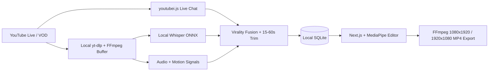

<div align="center">
  
</div>

<p align="center">
  
  
  
  
  
</p>

<p align="center">
  <strong>100% Free, Zero-Backend Open-Source YouTube Live &amp; VOD Viral Clip Studio</strong><br />
  Runs completely on your own PC - no cloud server, no Docker, no subscriptions.
</p>

<p align="center">
  Clipper turns YouTube live streams, full videos and your own local files into ready-to-post viral clips — automatically. It watches chat, audio, motion and speech to find the moments everyone will replay, transcribes them locally with word-level Whisper captions, follows the speaker's face with smart 9:16 layouts, and exports polished vertical or horizontal MP4s.
</p>

<p align="center">
  <a href="https://muse.ai/files/1449552968231931/1401354681799909/vtaxwfsm2hjzaluptdfvrinv/clipper-promo.mp4">
    
  </a>
  <br />
  <strong>&#9654; Watch the promo (34s)</strong>
</p>

---

## What Clipper Can Do

### Sources — bring any video in
- **YouTube Live streams**: paste a live URL and Clipper buffers the stream in rolling segments while it watches for viral moments in real time.
- **YouTube videos (VOD)**: paste any video URL — Clipper downloads the whole video, transcribes it in chunks and picks the top viral moments across the *entire* video.
- **Local video files**: use videos already on your own PC as a source, no download needed.
- **Resilient downloading**: automatic retries with backoff, auto-restart and resume if the app or pipeline restarts, YouTube throttle detection with honest status (downloading / retrying / blocked-waiting), player-client rotation, an optional force-IPv4 mode, and optional `cookies.txt` support for age-restricted or members-only videos.
- **Live chat reading**: follows the live chat of a stream to spot hype spikes the second they happen.

### Detection — find the moments worth clipping
- **Multi-signal virality scoring**: fuses live-chat spikes, audio loudness peaks, visual motion spikes and transcript analysis into one virality score per moment.
- **Transcript intelligence**: a built-in free hook/humor scorer works with zero API keys; optionally plug in **OpenAI, Anthropic, Ollama or Google Gemini** (with a one-click connection test in Settings) for smarter picks, titles and reasons.
- **Full-video AI picking**: for VODs, the best moments are selected across the whole transcript, not just the loudest seconds.
- **Your rules**: set the virality threshold and minimum/maximum clip length (e.g. 15–60s) and Clipper trims to match.
- **Live Monitor**: a real-time virality graph, chat-activity heatmap and a live feed of detected clips as they land.

### Captions — automatic and word-perfect
- **Offline Whisper transcription**: local ONNX Whisper models (downloaded once, to your machine) produce **word-level timestamps** — no audio ever leaves your PC.
- **8 caption templates**: Bold Pop, Karaoke Highlight, Minimal Clean, Neon Glow, Comic, Typewriter, Boxed and Gradient.
- **15+ showcase fonts** built in and auto-downloaded, plus upload your own `.ttf/.otf` fonts.
- **Profanity masking** and title overlays (top / bottom / hidden).

### Editor — make it look pro
- **Smart layouts**: Fullscreen, Stacked Collage, PIP Bubble, Split Blur and blurred-background modes.
- **Facecam auto-detection**: MediaPipe finds the facecam automatically — or drag the box yourself.
- **Face-tracking**: Clipper tracks the face across the whole clip, the live 9:16 preview follows the face left/center/right exactly like the final export, and **Auto-Track Face** regenerates tracking on demand.
- Change the caption template, font, layout and title position per clip and see it live before exporting.

### Export — post anywhere
- **Vertical 1080×1920** for Shorts / Reels / TikTok, **Horizontal 1920×1080** for YouTube, or **Both in one click**.
- 30 or 60 fps, adjustable quality (CRF), fast-start MP4s that play instantly everywhere.

### Library & Dashboard
- **Dashboard** for all your streams and downloads, with live status for each.
- **Clip Library**: vertical full-bleed clip cards with thumbnails and scores — search, and sort by score or most recent.
- **100% local, zero backend**: Electron + bundled FFmpeg + auto-fetched `yt-dlp` + a local SQLite database (`~/ClipperData/clipper.db`).

## Architecture


## Quick Install (Local PC)
```bash
git clone https://github.com/Danyalmalik2770/clipper.git
cd clipper
npm install
npm run dev
```

To generate the 512x512 desktop PNG icon and build a standalone installer (`.exe` / `.dmg` / `.AppImage`):
```bash
npx @resvg/resvg-js-cli build/icon.svg build/icon.png
npm run build
```

## How It Works
1. **Add a source** — a YouTube live stream, a YouTube video, or a local file.
2. **Clipper watches** — chat, audio, motion and speech are scored live on the Monitor.
3. **Clips appear** — the best moments land in your Library, already transcribed with word-level captions.
4. **Edit & export** — pick a layout and caption style, let face-tracking follow the speaker, then export vertical, horizontal, or both.

## Roadmap
- [ ] Twitch & Kick live ingest adapters
- [ ] Hardware NVENC / VideoToolbox GPU encoding toggle
- [ ] Multi-speaker diarization

## Disclaimer
Users must ensure they have explicit rights or permission from content creators/streamers before clipping, editing, or reposting content, and must comply with YouTube's Terms of Service and applicable copyright laws.
