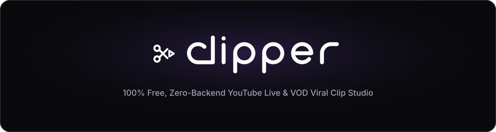
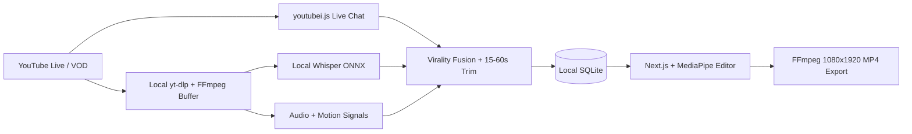

<div align="center">
  
</div>

<p align="center">
  <strong>100% Free, Zero-Backend Open-Source YouTube Live &amp; VOD Viral Clip Studio</strong><br />
  Runs completely on your own PC - no cloud server, no Docker, no subscriptions.
</p>

---

## Features
- **Zero-Backend Desktop Architecture**: Everything runs locally via Electron + bundled FFmpeg + auto-fetched `yt-dlp` + local SQLite (`~/ClipperData/clipper.db`).
- **Offline Word-Level Captions**: Powered by `@huggingface/transformers` Whisper ONNX models downloaded directly to your machine.
- **Multi-Signal Viral Detection (100% Free)**: Fuses live chat spikes (`youtubei.js`), audio loudness peaks, visual motion spikes, and built-in hook/humor scoring (with optional Ollama / OpenAI / Anthropic).
- **Smart 9:16 Layout Engine**: Auto-detects facecams locally via MediaPipe (`@mediapipe/tasks-vision`) + manual drag-to-select box, supporting **Fullscreen**, **Stacked Collage**, **PIP Bubble**, and **Split Blur**.
- **8+ Community JSON Caption Templates & 15+ Fonts**: Bold Pop, Karaoke Highlight, Minimal Clean, Neon Glow, Comic, Typewriter, Boxed, Gradient + custom `.ttf/.otf` upload.

## Architecture


## Quick Install (Local PC)
```bash
git clone https://github.com/your-org/clipper.git
cd clipper
npm install
npm run dev
```

To generate the 512x512 desktop PNG icon and build a standalone installer (`.exe` / `.dmg` / `.AppImage`):
```bash
npx @resvg/resvg-js-cli build/icon.svg build/icon.png
npm run build
```

## Usage Preview
- `[Dashboard Demo GIF Placeholder]`
- `[Live Monitor & 9:16 Facecam Editor GIF Placeholder]`

## Roadmap
- [ ] Twitch & Kick live ingest adapters
- [ ] Hardware NVENC / VideoToolbox GPU encoding toggle
- [ ] Multi-speaker diarization

## Disclaimer
Users must ensure they have explicit rights or permission from content creators/streamers before clipping, editing, or reposting content, and must comply with YouTube's Terms of Service and applicable copyright laws.
